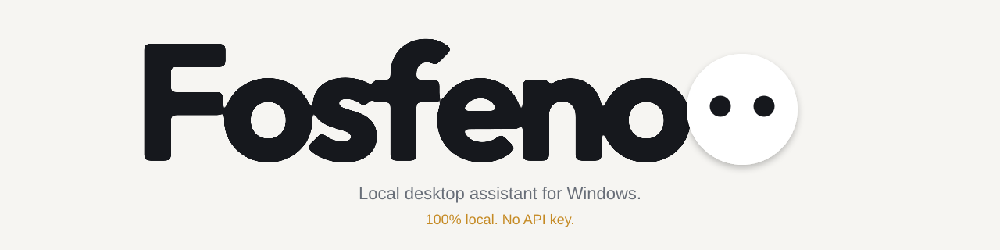
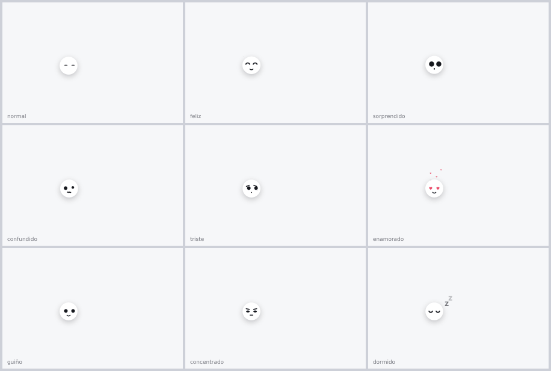
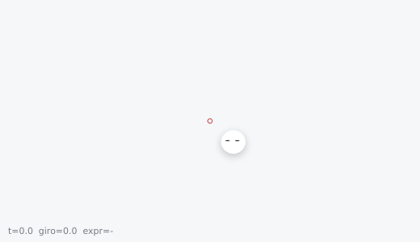
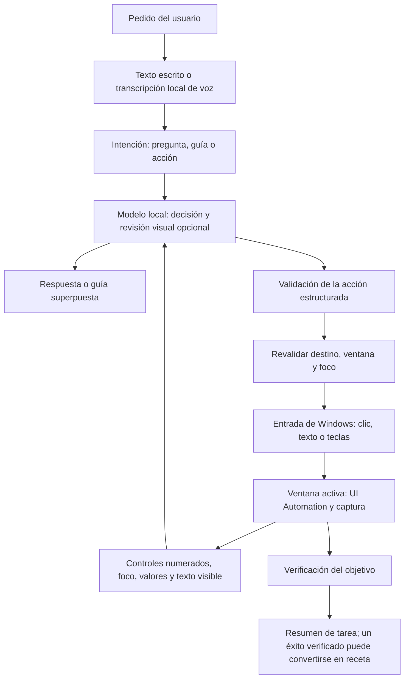

[English](README.md) | [Español](README.es.md)

<picture>
  <source media="(prefers-color-scheme: dark)" srcset="docs/assets/banner-dark-animated.svg">
  
</picture>

[](LICENSE)    

**Un asistente local que lee la ventana activa, señala controles y puede actuar según tu pedido.**

Fosfeno combina Windows UI Automation, modelos de visión locales y transcripción de voz con una capa animada en PySide6. Responde preguntas sobre la pantalla, te guía por una interfaz y puede hacer clic, escribir y pulsar teclas. Es un proyecto experimental: las acciones y la verificación pueden fallar. Lee [Seguridad y privacidad](#seguridad-y-privacidad) antes de habilitar acciones. Los documentos de [docs/](docs/) están en español.

[Qué hace](#qué-hace) · [Inicio rápido](#inicio-rápido) · [Cómo funciona](#cómo-funciona) · [Motores](#motores) · [Seguridad y privacidad](#seguridad-y-privacidad) · [Limitaciones](#limitaciones) · [Cómo se midió](#cómo-se-midió) · [Ejecutar las pruebas](#ejecutar-las-pruebas) · [Créditos](#créditos) · [Licencia](#licencia)

## Qué hace

- Responde preguntas sobre el contenido visible y señala controles.
- Ejecuta los clics, la escritura y los atajos de teclado solicitados, con cuenta atrás y cancelación.
- Graba demostraciones y guarda recetas y notas por aplicación. Las recetas son referencias que adapta al pedido actual; no garantizan una repetición exitosa. Ver [aprendizaje por demostración](docs/aprendizaje-general.md).
- De forma experimental, encadena subtareas, conserva datos breves entre ventanas y guarda un resumen final de la tarea. Ver [tareas y parámetros](docs/tareas-y-parametros.md).
- Describe la ventana actual de la aplicación y guarda un mapa; la exploración no recorre toda la aplicación.
- Muestra los estados de escucha, pensamiento y acción en una capa superpuesta. Admite varios monitores y trabaja en el que contiene la ventana activa.



El compañero también reacciona a la conversación y a los movimientos circulares rápidos del mouse.



## Inicio rápido

Requisitos de la documentación de instalación actual:

- Windows 10 u 11 y Python 3.10+.
- GPU NVIDIA con **8 GB de VRAM o más**. El modelo Q4 documentado, el proyector y el contexto de 16K usan unos 6–7 GB en conjunto; la instalación de referencia se probó con una RTX 5070 de 12 GB.
- Al menos 8 GB de RAM; 16 GB recomendados. La transcripción de voz se ejecuta en la CPU con el modelo Whisper `small` por defecto.
- Una compilación de [llama.cpp](https://github.com/ggml-org/llama.cpp) con CUDA, los pesos del modelo en GGUF y su proyector de visión correspondiente. Son independientes de las dependencias de Python.

Desde la carpeta del proyecto, instala las dependencias y copia la configuración de ejemplo. Estos comandos son para PowerShell; conserva los archivos locales de configuración si ya están configurados.

```powershell
python -m pip install -r requirements.txt
Copy-Item config.ejemplo.json config.json
Copy-Item vocabulario.ejemplo.txt vocabulario.txt
Copy-Item correcciones.ejemplo.txt correcciones.txt
```

El lanzador de servidores incluido resuelve las rutas respecto a la **carpeta padre del proyecto**. Prepara esta estructura antes de iniciarlo; los pesos y el entorno de ejecución no se incluyen en el repositorio:

```text
<parent>/
  <project>/                 # este repositorio
  bolt/
    NVIDIA-Nemotron-3.5-Bolt-E4B-UD-Q4_K_XL.gguf
    mmproj-F16.gguf
  llama-lfm3-b11946/
    llama-server.exe
  lfm3/                      # solo necesario para lfm3 o hibrido
    LFM3-VL-2B-Q8_0.gguf
    mmproj-LFM3-VL-2B-F16.gguf
```

El entorno de ejecución compatible documentado es llama.cpp b11946 con CUDA 13.4. Los pesos de LFM3 proceden de [LiquidAI/LFM3-VL-2B-GGUF](https://huggingface.co/LiquidAI/LFM3-VL-2B-GGUF). Conserva los nombres de carpetas anteriores al mover la instalación.

Inicia Nemotron desde la carpeta del proyecto:

```powershell
python servidores_lfm3.py --motor nemotron
```

Deja esa terminal abierta. En una segunda terminal, en la misma carpeta, inicia el asistente con pedidos escritos:

```powershell
python jarvis.py --motor nemotron --texto
```

Para usar el micrófono, ejecuta `python jarvis.py --motor nemotron` en su lugar. La transcripción está configurada en español (`language="es"`). Los archivos de los modelos deben estar disponibles localmente para usarlos sin conexión.

| Atajo por defecto | Comportamiento |
|---|---|
| `Ctrl+Alt+J` | Empieza a grabar; pulsa otra vez para detener y procesar el pedido |
| `Ctrl+Alt+K` | Solicita el modo de acción; también confirma una guía pendiente |
| `Esc` | Cancela antes de los clics o atajos y durante la escritura |

Usa `Ctrl+C` en la terminal del asistente para salir. En la terminal del lanzador, `Ctrl+C` cierra únicamente los servidores que inició ese lanzador. El lanzador reutiliza servidores listos e informa de modelos en conflicto o de la falta de visión, en vez de terminar un servidor existente. Sus registros se guardan en `salidas/servidor-*.log`.

`python demo.py` muestra las animaciones sin modelo ni micrófono. En `config.json`, `tecla` y `tecla_actuar` cambian las letras de los atajos; `buddy` controla el compañero en reposo y `tema` acepta `claro` u `oscuro`.

## Cómo funciona



El controlador mantiene el estado de la tarea, el progreso observado y las subtareas. Valida acciones estructuradas y comprueba el resultado antes de aceptar el final. No basta con que el modelo declare que terminó. La revisión visual y la verificación pueden equivocarse; no garantizan el éxito.

La capa superpuesta usa PySide6 y un efecto gooey propio. La voz usa `faster-whisper` en la CPU, independientemente del motor seleccionado.

## Motores

Los tres modos usan el mismo controlador de tareas con estado. Los puertos siguientes están en `127.0.0.1`.

| `--motor` | Modelo de decisión | Revisión visual | Puertos |
|---|---|---|---|
| `nemotron` | Nemotron 3.5 Bolt E4B, UD-Q4_K_XL | Nemotron con su proyector | 8095 |
| `lfm3` | LFM3-VL-2B, Q8_0 | LFM3 con su proyector | 8096 |
| `hibrido` | Nemotron | LFM3 | 8095 y 8096 |

Usa el mismo modo en `python servidores_lfm3.py --motor hibrido` y `python jarvis.py --motor hibrido --texto` al seleccionar el modo híbrido. Requiere ambos modelos; el requisito anterior de 8 GB de VRAM no es un requisito combinado medido para el modo híbrido.

La prioridad de selección es `--motor`, después `FOSFENO_MOTOR`, después `motor_ia` en `config.json` y finalmente `nemotron`. `lfm3-puro` es un alias de `lfm3` en el asistente; el lanzador de servidores acepta `lfm3`, `nemotron` e `hibrido`. Cambiar de motor no cambia la transcripción de voz.

## Seguridad y privacidad

- **Fosfeno puede hacer clic y escribir con tus permisos de usuario.** Usa ventanas donde un error sea recuperable. Todavía no exige confirmación antes de acciones sensibles como enviar, borrar o pagar.
- La inferencia usa servidores locales sin clave de API. Las aplicaciones que le pidas usar pueden acceder a internet y transmitir lo que escriba.
- El texto de la pantalla y los nombres de los controles se tratan como datos en lugar de instrucciones. Esto no elimina los errores del modelo.
- Las recetas y notas de `conocimiento/` pueden contener información visible o escrita. La grabación de demostraciones omite el contenido de los controles marcados como campos de contraseña.
- `salidas/` guarda capturas y trazas de depuración. `salidas/tareas/` guarda resultados en JSON/Markdown y datos conservados de la tarea; no se cargan automáticamente en tareas posteriores.
- La configuración local, el conocimiento aprendido y las salidas están excluidos por `.gitignore`, salvo el ejemplo de conocimiento incluido. Revisa los archivos generados antes de compartirlos; excluirlos de Git no los cifra.

## Limitaciones

- Los controles inaccesibles, las interfaces dibujadas a medida, las animaciones, los cambios de disposición y el contexto incompleto pueden romper la percepción o las acciones. Las aplicaciones elevadas pueden rechazar la entrada de teclado.
- Un modelo o verificador puede leer mal valores, asociar una entrada de tabla con una fila o columna incorrecta, repetir acciones, rechazar una tarea completada o aceptar una lectura incorrecta.
- El formato complejo de Word sigue incompleto. Los casos de desarrollo en escritorio incluyeron correcciones e intervenciones del operador; no establecen una tasa general de éxito.
- El recorrido nativo completo que incluye voz, atajos globales e inyección de entradas no se ha evaluado de principio a fin en las rondas documentadas.
- El piloto opcional de percepción OCR está desactivado por defecto. El aprendizaje visual está desactivado en ese modo; su vía inicial de navegación bloquea la escritura y las acciones de teclado. Una variante separada de edición de laboratorio requiere una ventana vinculada explícitamente. Ver [percepción experimental](docs/percepcion-hibrida.md) y [edición de laboratorio](docs/edicion-visual-laboratorio.md).
- La ampliación de demostración visual está implementada, pero sigue pendiente de validación. Ver [aprendizaje visual](docs/aprendizaje-visual.md).

## Cómo se midió

La [metodología de evaluación y los resultados](docs/evaluacion.md) distinguen simulación reproducible, capturas fijas y tareas de escritorio reales.

La comparación simulada documentada usó ocho tareas y dos semillas por tarea: Nemotron completó y verificó 16/16, mientras que LFM3-VL completó y verificó 2/16. La primera ronda posterior de escritorio completó 0/3 tareas con Nemotron. Son condiciones distintas y muestras pequeñas, no estimaciones de fiabilidad general.

El [informe de escritorio del 29 de octubre](docs/pruebas-escritorio-2026-10-29.md) registra correcciones posteriores, comprobaciones de archivos exitosas, falsos rechazos y fallos de formato pendientes. Esos casos de desarrollo y regresión no reemplazan la comparación histórica. Consulta los informes para conocer las intervenciones y los límites de cada resultado.

## Ejecutar las pruebas

Desde la carpeta del proyecto, después de instalar las dependencias de Python:

```powershell
python -m unittest discover -s tests -v
```

Las pruebas comprueban las reglas del controlador y el entorno de evaluación sin enviar entradas al escritorio. Para reproducir la comparación simulada, inicia ambos servidores con `python servidores_lfm3.py --motor hibrido` y ejecuta en otra terminal:

```powershell
python evaluacion.py --motores lfm3,nemotron --semillas 42,99
```

Esta comparación consulta los modelos locales sin operar la PC. Escribe resultados, trazas, identidad del modelo y huellas de las fuentes en `salidas/evaluacion/`. Las pruebas simuladas no sustituyen tareas completas en aplicaciones reales.

## Créditos

- **Jarvis** es el origen de la idea: un asistente que ve la pantalla y ayuda a usar el computador. Es un personaje de ficción de Marvel; este proyecto no tiene relación con Marvel.
- **Clicky** aportó una inspiración ligera para la interacción mediante atajo, voz y señalamiento. No se usó su código.
- **[liquid-gooey](https://libraries.dev/gooey)** inspiró el efecto gooey de desenfoque y umbral; los valores por defecto de desenfoque, contraste y resortes se tomaron de su código con licencia MIT. El efecto está reimplementado en Python y Qt sin usar el paquete.
- **[thinking-orbs](https://libraries.dev/orbs)** inspiró las animaciones de esferas de puntos al escuchar y pensar, reescritas en Python a partir de la biblioteca con licencia MIT.
- **[faster-whisper](https://github.com/SYSTRAN/faster-whisper)** proporciona la transcripción; **[llama.cpp](https://github.com/ggml-org/llama.cpp)** sirve los modelos locales.

## Licencia

MIT. Ver [LICENSE](LICENSE). Los pesos de los modelos tienen sus propias licencias; revísalas por separado antes de usarlos o redistribuirlos.
