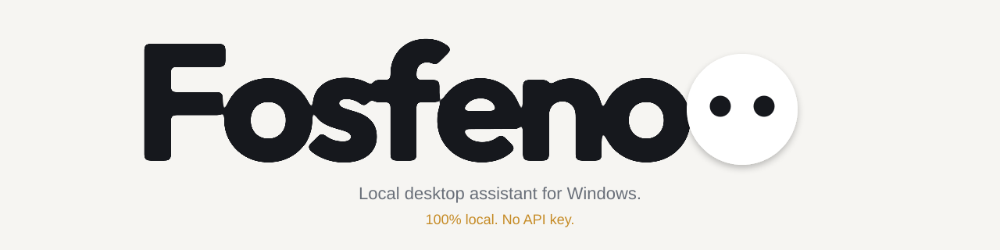
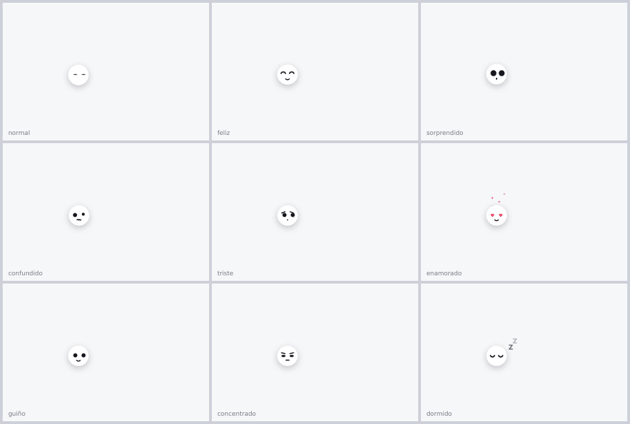
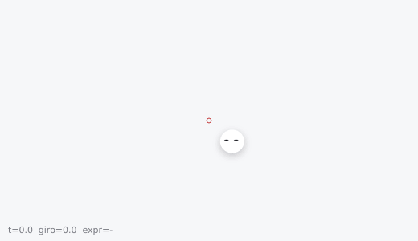
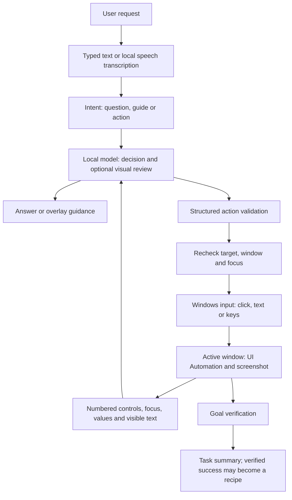

[English](README.md) | [Español](README.es.md)

<picture>
  <source media="(prefers-color-scheme: dark)" srcset="docs/assets/banner-dark-animated.svg">
  
</picture>

[](LICENSE)    

**A local assistant that reads the active window, points to controls and can act on your request.**

Fosfeno combines Windows UI Automation, local vision models and speech transcription with an animated PySide6 overlay. It answers questions about the screen, guides you through an interface and can click, type and press keys. This is an experimental project: actions and verification can fail. Read [Safety and privacy](#safety-and-privacy) before enabling actions. The documents in [docs/](docs/) are in Spanish.

[What it does](#what-it-does) · [Quick start](#quick-start) · [How it works](#how-it-works) · [Engines](#engines) · [Safety and privacy](#safety-and-privacy) · [Limitations](#limitations) · [How it was measured](#how-it-was-measured) · [Running the tests](#running-the-tests) · [Credits](#credits) · [License](#license)

## What it does

- Answers questions about visible content and points to controls.
- Executes requested clicks, text entry and keyboard shortcuts, with a countdown and cancellation.
- Records demonstrations and saves application recipes and notes. Recipes are references to adapt to the current request; they do not guarantee successful replay. See [learning from demonstrations](docs/aprendizaje-general.md).
- Experimentally chains subtasks, retains brief data across windows and saves a final task summary. See [tasks and parameters](docs/tareas-y-parametros.md).
- Describes the current application window and saves a map; exploration does not traverse the whole application.
- Shows listening, thinking and action states in an overlay. It supports multiple monitors and works on the monitor containing the active window.



The companion also reacts to conversation and rapid circular mouse movement.



## Quick start

Requirements from the current installation documentation:

- Windows 10 or 11 and Python 3.10+.
- An NVIDIA GPU with **8 GB of VRAM or more**. The documented Q4 model, projector and 16K context use about 6–7 GB together; the reference installation was tested on a 12 GB RTX 5070.
- At least 8 GB of RAM; 16 GB recommended. Speech transcription runs on the CPU with the Whisper `small` model by default.
- A CUDA build of [llama.cpp](https://github.com/ggml-org/llama.cpp), GGUF model weights and the matching vision projector. These are separate from the Python dependencies.

From the project folder, install dependencies and copy the example configuration. These commands are for PowerShell; keep existing local configuration files if already configured.

```powershell
python -m pip install -r requirements.txt
Copy-Item config.ejemplo.json config.json
Copy-Item vocabulario.ejemplo.txt vocabulario.txt
Copy-Item correcciones.ejemplo.txt correcciones.txt
```

The bundled server launcher resolves paths relative to the **parent of the project folder**. Prepare this layout before starting it; weights and runtime are not included in the repository:

```text
<parent>/
  <project>/                 # this repository
  bolt/
    NVIDIA-Nemotron-3.5-Bolt-E4B-UD-Q4_K_XL.gguf
    mmproj-F16.gguf
  llama-lfm3-b11946/
    llama-server.exe
  lfm3/                      # only needed for lfm3 or hibrido
    LFM3-VL-2B-Q8_0.gguf
    mmproj-LFM3-VL-2B-F16.gguf
```

The documented compatible runtime is llama.cpp b11946 with CUDA 13.4. The LFM3 weights are from [LiquidAI/LFM3-VL-2B-GGUF](https://huggingface.co/LiquidAI/LFM3-VL-2B-GGUF). Keep the folder names above when moving the installation.

Start Nemotron from the project folder:

```powershell
python servidores_lfm3.py --motor nemotron
```

Leave that terminal open. In a second terminal in the same folder, start with typed requests:

```powershell
python jarvis.py --motor nemotron --texto
```

For microphone input, run `python jarvis.py --motor nemotron` instead. Transcription is configured for Spanish (`language="es"`). Model files must be available locally for offline use.

| Default shortcut | Behavior |
|---|---|
| `Ctrl+Alt+J` | Starts recording; press again to stop and process the request |
| `Ctrl+Alt+K` | Requests action mode; also confirms a pending guide |
| `Esc` | Cancels before clicks or shortcuts and during typing |

Use `Ctrl+C` in the assistant terminal to exit. In the launcher terminal, `Ctrl+C` closes only the servers that launcher started. The launcher reuses ready servers and reports conflicting models or missing vision support rather than terminating an existing server. Its logs go to `salidas/servidor-*.log`.

`python demo.py` displays the animations without a model or microphone. In `config.json`, `tecla` and `tecla_actuar` change shortcut letters; `buddy` controls the idle companion, and `tema` accepts `claro` or `oscuro`.

## How it works



The controller tracks task state, observed progress and subtasks. It validates structured actions and checks the result before accepting completion. A model declaring completion is insufficient on its own. Visual review and verification can still be wrong; they are not guarantees of success.

The overlay uses PySide6 and a custom gooey effect. Speech uses `faster-whisper` on the CPU, independently of the selected engine.

## Engines

All three modes use the same stateful task controller. The ports below are on `127.0.0.1`.

| `--motor` | Decision model | Visual review | Ports |
|---|---|---|---|
| `nemotron` | Nemotron 3.5 Bolt E4B, UD-Q4_K_XL | Nemotron with its projector | 8095 |
| `lfm3` | LFM3-VL-2B, Q8_0 | LFM3 with its projector | 8096 |
| `hibrido` | Nemotron | LFM3 | 8095 and 8096 |

Use the same mode for `python servidores_lfm3.py --motor hibrido` and `python jarvis.py --motor hibrido --texto` when selecting the hybrid mode. It requires both models; the 8 GB VRAM requirement above is not a measured combined requirement for hybrid mode.

Selection precedence is `--motor`, then `FOSFENO_MOTOR`, then `motor_ia` in `config.json`, then `nemotron`. `lfm3-puro` is an assistant alias for `lfm3`; the server launcher accepts `lfm3`, `nemotron` and `hibrido`. Changing engines does not change speech transcription.

## Safety and privacy

- **Fosfeno can click and type with your user permissions.** Use windows where a mistake is recoverable. It does not yet require confirmation before sensitive actions such as sending, deleting or paying.
- Inference uses local servers without an API key. Applications you ask it to operate may access the internet and transmit what it enters.
- Screen text and control names are treated as data rather than instructions. This does not eliminate model errors.
- Recipes and notes in `conocimiento/` can contain visible or typed information. Demonstration recording skips the content of controls marked as password fields.
- `salidas/` stores screenshots and debugging traces. `salidas/tareas/` stores task results in JSON/Markdown and retained task data; these are not automatically loaded into later tasks.
- Local configuration, learned knowledge and outputs are excluded by `.gitignore`, apart from the supplied knowledge example. Review generated files before sharing them; exclusion from Git does not encrypt them.

## Limitations

- Inaccessible controls, custom-drawn interfaces, animation, layout changes and incomplete context can break perception or actions. Elevated applications can reject keyboard input.
- A model or verifier may misread values, associate a table entry with the wrong row or column, repeat actions, reject a completed task or accept an incorrect reading.
- Complex Word formatting remains incomplete. Desktop development cases included corrections and operator interventions; they do not establish a general success rate.
- The full native path covering voice, global shortcuts and input injection has not been evaluated end to end in the documented rounds.
- The optional OCR perception pilot is disabled by default. Visual learning is disabled in that mode; its initial navigation path blocks typing and keyboard actions. A separate laboratory editing variant requires an explicitly bound window. See [experimental perception](docs/percepcion-hibrida.md) and [laboratory editing](docs/edicion-visual-laboratorio.md).
- The visual demonstration extension is implemented but still awaiting validation. See [visual learning](docs/aprendizaje-visual.md).

## How it was measured

The [evaluation methodology and results](docs/evaluacion.md) distinguish repeatable simulation, fixed screenshots and real desktop tasks.

The documented simulated comparison used eight tasks and two seeds per task: Nemotron completed and verified 16/16, while LFM3-VL completed and verified 2/16. The first subsequent desktop round completed 0/3 tasks with Nemotron. These are different conditions and small samples, not estimates of general reliability.

The [29 October desktop report](docs/pruebas-escritorio-2026-10-29.md) records later fixes, successful file checks, false rejections and remaining formatting failures. Those development and regression cases do not replace the historical comparison. Consult the reports for interventions and the limits of each result.

## Running the tests

From the project folder, after installing the Python dependencies:

```powershell
python -m unittest discover -s tests -v
```

The tests check controller rules and the evaluation environment without sending input to the desktop. To reproduce the simulated comparison, start both servers with `python servidores_lfm3.py --motor hibrido`, then run in another terminal:

```powershell
python evaluacion.py --motores lfm3,nemotron --semillas 42,99
```

This comparison queries the local models without operating the PC. It writes results, traces, model identity and source fingerprints to `salidas/evaluacion/`. Simulated tests do not replace complete tasks in real applications.

## Credits

- **Jarvis** is the origin of the idea: an assistant that sees the screen and helps operate the computer. It is a fictional Marvel character; this project is unaffiliated with Marvel.
- **Clicky** provided light inspiration for the shortcut, voice and pointing interaction. Its code was not used.
- **[liquid-gooey](https://libraries.dev/gooey)** inspired the blur-and-threshold gooey effect; default blur, contrast and spring values were taken from its MIT-licensed code. The effect is reimplemented in Python and Qt without using the package.
- **[thinking-orbs](https://libraries.dev/orbs)** inspired the listening and thinking point-sphere animations, rewritten in Python from the MIT-licensed library.
- **[faster-whisper](https://github.com/SYSTRAN/faster-whisper)** provides transcription; **[llama.cpp](https://github.com/ggml-org/llama.cpp)** serves the local models.

## License

MIT. See [LICENSE](LICENSE). Model weights have their own licenses; review them separately before use or redistribution.
