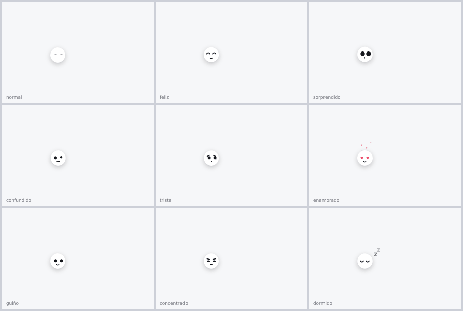
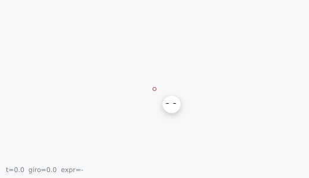

# Fosfeno

Un asistente de escritorio **100 % local** para Windows: mantienes un atajo, le hablas, él mira tu pantalla, te señala dónde está lo que buscas y, si se lo pides, hace clic y escribe por ti. Lo acompaña una pequeña bolita animada con sus propias expresiones.

> Estado: proyecto experimental, en desarrollo. Funciona, pero comete errores. Léete la sección de [seguridad](#seguridad-y-privacidad) antes de dejarlo actuar solo.

La idea nace de la fantasía del asistente tipo **Jarvis** (un compañero que ve lo que ves y te ayuda a usar el computador), con una inspiración ligera en **Clicky** y en el estilo de animación de dos librerías de [libraries.dev](https://libraries.dev) (ver [créditos](#créditos-e-inspiración)).



## Qué hace

- **Pregunta:** "¿qué significa este error?" responde con lo que ve en pantalla.
- **Guía:** "¿cómo abro una pestaña nueva?" te señala el botón con una animación y te ofrece hacerlo por ti.
- **Hazlo:** "abre WhatsApp y dile hola a Mamá" hace clic, escribe y pulsa teclas, paso a paso, con cuenta atrás y cancelación con `Esc`.
- **Aprende por demostración:** "mírame cómo se crea un usuario" observa lo que haces, limpia los errores y guarda una receta.
- **Explora una app:** "explora esta app" describe los controles visibles y guarda un mapa de esa ventana. Ver las limitaciones actuales más abajo.
- **Se corrige con la voz:** "no, era el botón de arriba" o "recuerda que aquí se guarda con Ctrl+S".
- **Se marea** si das muchas vueltas con el mouse.
- **Conversa:** responde con expresiones a "gracias", "hola", "buen trabajo", "¿cómo estás?" y similares, sin tocar nada.
- **Lee y cuenta:** "dime qué dice el último mensaje de Ana" navega hasta el chat y te lo dice en pantalla.
- **Se nota cuando actúa:** mientras piensa o usa la PC, el cursor se reemplaza por una gota de color con anillos al hacer clic.
- **Varias pantallas:** se ve en todos los monitores y trabaja sobre el que tiene la ventana activa.



## Cómo funciona

1. Windows **UI Automation** lista los elementos reales de la ventana activa (botones, campos, pestañas, barra de tareas).
2. Cada elemento se numera sobre la captura. El controlador recibe la lista, el foco, los valores y el texto visible; puede revisar también la imagen con un modelo de visión **local** vía `llama-server`.
3. Un clasificador distingue preguntas, guías y órdenes. Para actuar, el modelo devuelve una acción estructurada; el controlador valida el destino, observa el resultado y verifica el objetivo antes de darlo por terminado.
4. La voz se transcribe con `faster-whisper` en la CPU.
5. Una capa transparente en PySide6 dibuja la bolita, las señales y los mensajes, con un efecto gooey (desenfoque + contraste) propio.

La inferencia corre en tu máquina. Las aplicaciones que le pidas usar pueden acceder a internet y enviar lo que escribas en ellas.

## Requisitos

- Windows 10 u 11.
- Python 3.10 o superior.
- GPU NVIDIA con **8 GB de VRAM** o más. El modelo cuantizado (Q4) ocupa unos 4,7 GB, el `mmproj` 0,9 GB y el contexto de 16K unos 1-2 GB más, así que en total usa entre 6 y 7 GB. Se probó con una RTX 5070 de 12 GB.
- 8 GB de RAM como mínimo (16 GB recomendados). La voz (`faster-whisper`, modelo `small`) corre en la CPU y usa cerca de 1 GB.
- [llama.cpp](https://github.com/ggml-org/llama.cpp) con `llama-server` compilado con CUDA.
- Modelo y visión, en GGUF: `NVIDIA-Nemotron-3.5-Bolt-E4B-UD-Q4_K_XL.gguf` y `mmproj-F16.gguf` (o `mmproj-Q8_0.gguf`, que pesa la mitad).

Con menos de 8 GB de VRAM baja el contexto (`-c 8192`) y usa el `mmproj` Q8.

## Instalación

```
git clone https://github.com/elnachto/fosfeno.git
cd fosfeno
python -m pip install -r requirements.txt
copy config.ejemplo.json config.json
copy vocabulario.ejemplo.txt vocabulario.txt
copy correcciones.ejemplo.txt correcciones.txt
```

Arranca el servidor del modelo en otra ventana (ajusta las rutas):

```
llama-server -m RUTA\NVIDIA-Nemotron-3.5-Bolt-E4B-UD-Q4_K_XL.gguf --mmproj RUTA\mmproj-F16.gguf --alias fosfeno-nemotron -ngl 99 -c 16384 -np 1 -fa on --jinja --host 127.0.0.1 --port 8095
```

Y luego:

```
python jarvis.py
```

### Elegir motor

Los tres motores usan el mismo controlador de tareas con estado explícito.
El modo `lfm3` utiliza solo LFM3; el modo `hibrido` utiliza Nemotron para decidir
y LFM3 para describir la pantalla en las revisiones visuales.

| Opción `--motor` | Modelos | Arrancar servidores en `D:\LOCALai` | Arrancar el asistente en el proyecto |
|---|---|---|---|
| `nemotron` | Nemotron con visión, puerto 8095 | `iniciar-nemotron.bat` | `fosfeno-nemotron.bat` |
| `lfm3` | LFM3-VL-2B, puerto 8096 | `iniciar-lfm3.bat` | `fosfeno-lfm3.bat` |
| `hibrido` | Nemotron + LFM3, puertos 8095 y 8096 | `iniciar-hibrido.bat` | `fosfeno-hibrido.bat` |

Ejemplo: `python jarvis.py --motor nemotron --texto`.
Sin `--motor`, se usa `FOSFENO_MOTOR`, después `motor_ia` en `config.json`
y finalmente `nemotron`. `lfm3-puro` se conserva como alias de `lfm3`.
La voz sigue usando Whisper; elegir motor no cambia el micrófono.

Los accesos `iniciar-*.bat` de la tabla pertenecen a la instalación local y
están fuera de este repositorio. Desde el proyecto se puede ejecutar
`python servidores_lfm3.py --motor nemotron` y, en otra ventana,
`python jarvis.py --motor nemotron`, manteniendo la estructura de carpetas
de modelos y runtime que se describe a continuación.

`servidores_lfm3.py` arranca los servidores indicados, comprueba el modelo y
la disponibilidad de visión, y reutiliza los que ya están listos. `Ctrl+C`
cierra únicamente los procesos que inició esa ventana. Los registros están
en `salidas/servidor-*.log`. Si hay un servidor antiguo sin visión o con otro
modelo en el mismo puerto, el lanzador indica que hay que cerrarlo; no lo mata.

LFM3 usa los archivos oficiales de
[LiquidAI/LFM3-VL-2B-GGUF](https://huggingface.co/LiquidAI/LFM3-VL-2B-GGUF):
`LFM3-VL-2B-Q8_0.gguf` y `mmproj-LFM3-VL-2B-F16.gguf`, en
`D:\LOCALai\lfm3` (unos 2,23 GB en disco). El servidor compatible es
`llama.cpp` b11946 CUDA 13.4, en `D:\LOCALai\llama-lfm3-b11946`.
Nemotron mantiene los pesos y el proyector existentes en `D:\LOCALai\bolt`.
Las rutas de los modelos y ejecutables se resuelven respecto a la carpeta
padre del proyecto; al mover la instalación hay que mantener esa estructura.

### Control de tareas

- Las decisiones reciben el campo enfocado, su valor, el texto visible y el
  resultado observado de las acciones anteriores. También reciben el estado
  disponible de casillas, pestañas y selectores.
- Las acciones se generan como JSON restringido y se validan antes de usarse.
  El razonamiento interno nunca se ejecuta como una orden.
- Una escritura dirigida a otro campo primero lo enfoca y solo continúa si
  ese mismo destino y la ventana siguen siendo los esperados.
- Los números de los controles pueden cambiar. La detección de repeticiones
  usa la identidad del control y permite flechas o desplazamiento repetidos
  cuando hay progreso observable.
- Antes del clic se revalida su destino. Antes de escribir se comprueban foco
  y ventana; `Esc` puede cancelar durante la escritura y antes de los atajos.
- Declarar `LISTO` o quedarse sin un paso posible activa una verificación
  separada. Solo un éxito verificado puede guardarse como receta automática.

Esto sigue siendo experimental: interfaces que no exponen sus controles,
animaciones, cambios de disposición, contexto incompleto y decisiones del
modelo pueden causar fallos. No hay una garantía para cualquier aplicación.

### Pruebas reproducibles

`python -m unittest discover -s tests -v` comprueba las reglas del controlador
y el entorno de evaluación sin enviar entradas al escritorio.

`python evaluacion.py --motores lfm3,nemotron --semillas 42,99`
compara ambos motores contra las mismas ocho tareas simuladas, con el mismo
controlador, parámetros de muestreo y condiciones iniciales. No opera la PC.
Guarda resultados, trazas, modelo real consultado y huellas de las fuentes en
`salidas/evaluacion/`. Las pruebas simuladas y sobre capturas no sustituyen
la validación de tareas completas en aplicaciones reales. Ver `docs/evaluacion.md`.

### Estado de pruebas y limitaciones conocidas

Resultados de la instalación local, revisados el 28 de octubre de 2026:

| Evaluación | Nemotron | LFM3-VL |
|---|---|---|
| Ocho tareas simuladas, dos semillas por tarea | 16/16 completas y verificadas | 2/16 completas y verificadas |
| Una tarea por aplicación en Word, Explorador y Bloc de notas | 0/3 completas | No evaluado en esta ronda |

La ronda real usó decisiones del controlador sobre controles de Windows y
un adaptador para ejecutar las entradas, con observación entre pasos. Se
detuvo ante ciclos sin progreso, sin agotar su presupuesto de acciones. No
incluyó voz ni el recorrido completo de los atajos e inyección nativa.
Son muestras pequeñas; el resultado simulado no estima la fiabilidad general.

- Word puede informar el foco como documento y el destino como campo editable;
  el controlador insiste en enfocarlo y no llega a escribir.
- En el Explorador aparecieron ciclos al intentar seleccionar varios archivos.
  En Bloc de notas se hizo un reemplazo parcial, pero no se completó ni guardó
  el pedido. La detección de ciclos de varios pasos sigue pendiente.
- Las demostraciones y mapas se guardan. La rama del controlador con estado
  todavía no incorpora las notas y recetas al decidir acciones, aunque la
  consola pueda mostrar recetas encontradas. Las preguntas sí pueden usar notas.
- Explorar describe una captura; no recorre toda la aplicación ni valida sus
  procedimientos. Investigar manuales y enseñar aplicaciones por etapas es una
  ampliación propuesta, todavía sin implementar.

## Uso

| Atajo | Acción |
|---|---|
| `Ctrl+Alt+J` | Empieza a escuchar; al pulsar otra vez termina y decide qué hacer |
| `Ctrl+Alt+K` | Fuerza el modo "hazlo"; también confirma una guía |
| `Esc` | Cancela antes del clic o atajo y durante la escritura |

Otras formas de ejecutarlo:

- `python jarvis.py --texto` escribes la orden en la consola en vez de hablar.
- `python demo.py` solo muestra las animaciones, sin modelo ni micrófono.

Cosas para probar:

- "¿Qué es esto que veo?" / "Explícame esta página"
- "¿Cómo abro una pestaña nueva?"
- "Abre una pestaña nueva y busca el clima en La Paz"
- "Explora esta app" y luego pídele algo en esa app
- "Mírame cómo envío un mensaje aquí" y, después, "envía un mensaje que diga hola"
- "Olvida eso" / "¿Qué aprendiste aquí?"

## Configuración

`config.json` (no se sube al repositorio):

| Clave | Para qué sirve |
|---|---|
| `mic` | Micrófono elegido (se guarda solo) |
| `modelo` | Modelo de Whisper: `small` por defecto |
| `motor_ia` | `nemotron` (por defecto), `lfm3` o `hibrido`; `--motor` tiene prioridad |
| `tecla`, `tecla_actuar` | Letras de los atajos |
| `buddy` | Muestra la bolita en reposo |
| `tema` | `claro` u `oscuro` |
| `color_accion` | Color de la gota al actuar, por ejemplo `[124, 92, 255]` |
| `ocultar_cursor` | `true` oculta el cursor del sistema mientras actúa (por defecto) |

## Seguridad y privacidad

- **Puede hacer clic y escribir como si fueras tú.** Úsalo en ventanas donde un error no cause daño. Todavía no pide confirmación antes de acciones sensibles (enviar, borrar, pagar); está en la lista de pendientes.
- El texto y los nombres de la pantalla se tratan como **datos, nunca como órdenes**; solo cuenta lo que dices tú. Aun así, un modelo pequeño puede equivocarse.
- Lo que aprende se guarda en `conocimiento/` (recetas y notas por app) y puede incluir texto que escribas o nombres que vea. **Está excluido de git** salvo la nota de ejemplo de Visual Studio Code. Revísalo antes de compartirlo.
- "Mírame" no guarda el contenido de campos de contraseña.
- `salidas/` guarda capturas y registros de cada paso para depurar; también está excluida.

## Estructura

| Archivo | Qué hace |
|---|---|
| `jarvis.py` | Programa principal: atajos, flujo y decisiones |
| `marcas.py` | Lee la pantalla, arma la lista numerada y habla con el modelo |
| `motor_ia.py` | Perfiles de Nemotron y LFM3: servidor y parámetros de generación |
| `agente.py` | Estado, validación de acciones, continuidad de escritura y verificación del objetivo |
| `servidores_lfm3.py` | Arranque y comprobación de los servidores de los tres modos |
| `evaluacion.py` | Comparación reproducible en ocho tareas simuladas |
| `overlay.py` | La bolita, las expresiones y el efecto gooey |
| `acciones.py` | Clic, teclas y escritura con `SendInput` |
| `voz.py` | Micrófono y transcripción |
| `memoria.py` | Recetas, notas y correcciones |
| `mirame.py` | Grabación de demostraciones |
| `demo.py` | Muestra las animaciones |

## Créditos e inspiración

- **Jarvis**: la idea general del asistente que ve tu pantalla. Es un personaje de ficción de Marvel; este proyecto no tiene ninguna relación con Marvel.
- **Clicky** (Farza): inspiración ligera para el flujo de "mantén un atajo, habla y te señala dónde está". No se usó su código.
- **[liquid-gooey](https://libraries.dev/gooey)** (MIT): la técnica del efecto gooey (desenfoque gaussiano y contraste con un valor de corte) y los valores por defecto de desenfoque, contraste y resortes se tomaron de su código. Esta versión es una reimplementación propia en Python y Qt, no usa el paquete.
- **[thinking-orbs](https://libraries.dev/orbs)** (MIT): la bolita muestra una esfera de puntos al escuchar ("onda") y otra al pensar ("globo"), basadas en las animaciones de esa librería, reescritas en Python.
- [faster-whisper](https://github.com/SYSTRAN/faster-whisper) para la transcripción y [llama.cpp](https://github.com/ggml-org/llama.cpp) para servir el modelo.
- El modelo de visión es NVIDIA Nemotron; revisa su licencia antes de usarlo o redistribuirlo.

## Licencia

MIT. Ver [LICENSE](LICENSE).
